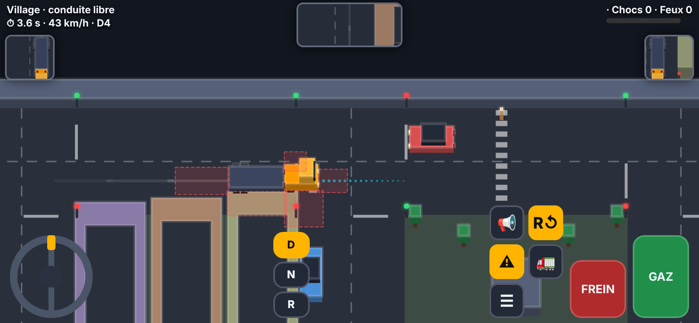
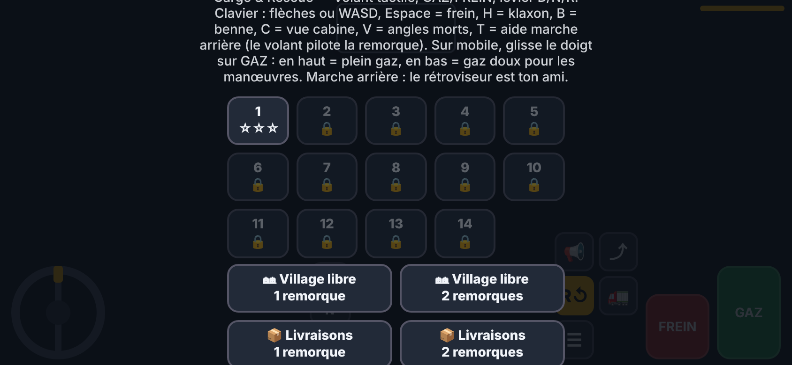
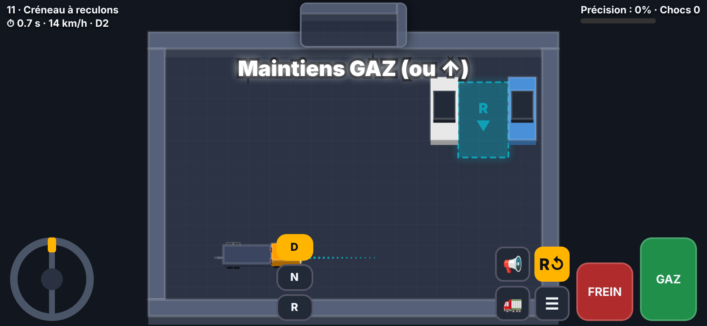

# 🚛 Convoy Extreme : Cargo & Rescue

Un jeu de conduite de **camion avec remorque articulée**, jouable directement dans le navigateur (mobile et ordinateur). Un seul fichier HTML, aucune installation, aucune dépendance.

## ▶️ Jouer

👉 **https://VOTRE-PSEUDO.github.io/convoy-extreme/** (remplacez `VOTRE-PSEUDO` par votre nom d'utilisateur GitHub)

Ou ouvrez simplement `index.html` dans Chrome / Safari / Firefox.

## 🎮 Contenu

- **Campagne de 14 niveaux** avec étoiles sauvegardées dans le navigateur :
  - 1 à 4 : créneaux de précision (jusqu'à la double remorque)
  - 5 à 8 : *Rush Hour* avec cargaison instable (gravier, liquide)
  - 9 et 10 : convoi à double remorque dans un labyrinthe
  - 11 à 14 : **parking uniquement en marche arrière**
- **Village en conduite libre** : circulation, feux tricolores, piétons, angles morts, rétroviseurs.
- **Missions de livraison** (1 ou 2 remorques) avec chronomètre.
- **Vue du dessus** ou **vue cabine** (pseudo-3D).
- **Garage** : améliorations de suspension et de moteur, peintures.
- Boîte de vitesses automatique, cargaison qui bouge, **aide à la marche arrière** (le volant pilote la remorque).

| Menu | Parking |
|---|---|
|  |  |

## 🕹️ Commandes

**Mobile** : volant tactile à gauche, levier D/N/R, pédales FREIN et GAZ à droite (glissez le doigt sur GAZ : en haut = plein gaz, en bas = gaz doux).

| Bouton | Action |
|---|---|
| 📢 | Klaxon |
| ⤴ | Benne |
| R↺ | Aide à la marche arrière |
| ⚠ | Angles morts (village) |
| 🚛 / 🗺 | Vue cabine / vue du dessus |
| ☰ | Menu |

**Clavier** : flèches ou WASD, `Espace` = frein, `H` = klaxon, `B` = benne, `C` = changer de vue, `V` = angles morts, `T` = aide marche arrière.

## 🎬 Vidéos

- [`media/convoy-extreme-teaser.mp4`](media/convoy-extreme-teaser.mp4) : teaser parking en marche arrière
- [`media/convoy-extreme-village.mp4`](media/convoy-extreme-village.mp4) : conduite dans le village

## 🚀 Publier sur GitHub Pages

1. Créez un dépôt public nommé `convoy-extreme` sur GitHub.
2. Envoyez tous les fichiers de ce dossier (le fichier `index.html` doit être à la racine).
3. Allez dans **Settings → Pages**.
4. Sous **Build and deployment**, choisissez **Deploy from a branch**, branche **main**, dossier **/ (root)**, puis **Save**.
5. Attendez une à deux minutes : le jeu est en ligne à l'adresse indiquée en haut de la page Pages.

## 🛠️ Technique

HTML5 Canvas 2D, JavaScript pur. Cinématique d'attelage articulé, cargaison simulée par ressorts amortis, rendu 2,5D en vue du dessus et rendu pseudo-3D en vue cabine. Sauvegarde dans `localStorage`.

## 📄 Licence

MIT, voir [LICENSE](LICENSE). Pensez à remplacer `[Votre nom]` dans ce fichier.
